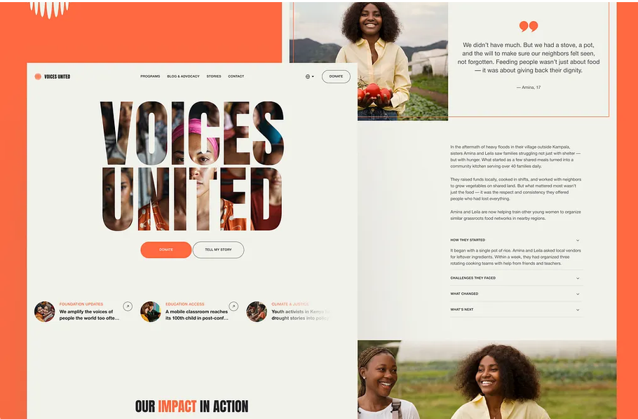
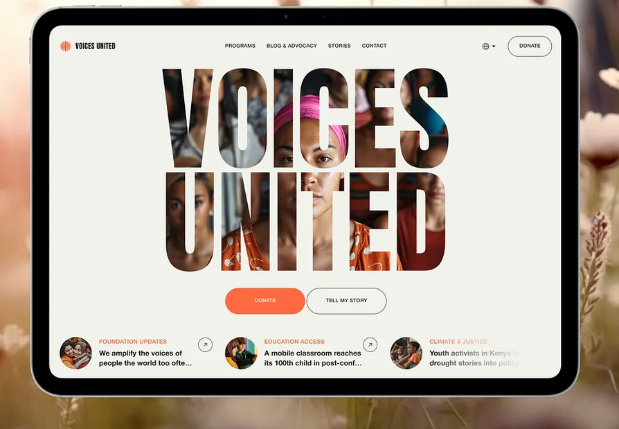
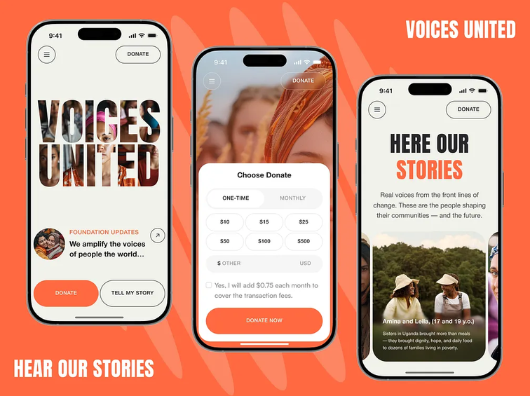
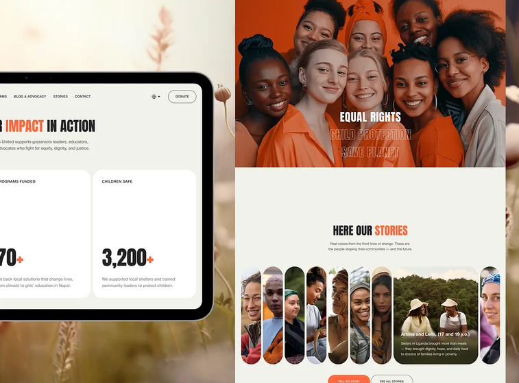
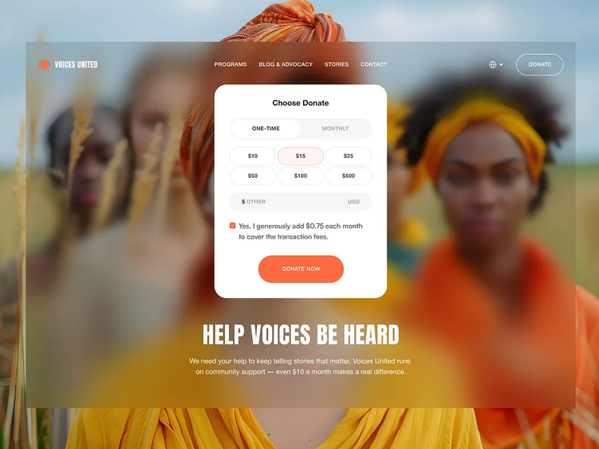
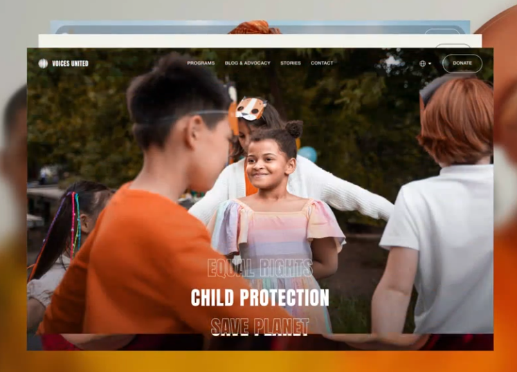

# Design-Briefing: „Voices United“ → Disinfo Awareness

## Worum es geht

Die Website von **Disinfo Awareness** (disinfoawareness.eu) bekommt ein neues Design.
Als Vorlage dient dieser Dribbble-Shot:

**„Voices United – Nonprofit Organization Website Design“**
https://dribbble.com/shots/26183245-Voices-United-Nonprofit-Organization-Website-Design

**Die Aufgabe ist, dieses Design auf unsere Inhalte zu adaptieren.** Wir übernehmen den Stil:
Farbwelt, Typografie, Formen, Layout-Ideen und Interaktionen.
**Unsere eigenen** bleiben Texte, Bilder, Logo, Seitenstruktur und Funktionen.
Die Vorlage ist eine Richtung, keine Kopiervorlage. Wo sie nicht zu uns passt, gehen unsere Inhalte vor.

Dieser Ordner enthält:

```
design/
├── design.md        ← dieses Briefing
└── referenz/        ← Screenshots der Vorlage (nur zur Orientierung, siehe Abschnitt 6)
```

---

## 1. Die Referenzbilder

| Bild | Was man darauf sieht |
|---|---|
| [01 – Desktop: Startseite + Story-Seite](referenz/01-desktop-startseite-und-story-seite.png) | Startseite mit Bild-im-Text-Hero, Buttons und News-Leiste; daneben eine Detailseite mit Zitat-Karte, Fließtext und Akkordeon |
| [02 – Hero (Tablet)](referenz/02-hero-bild-im-text.png) | Der Hero in Nahaufnahme: Navigation, riesiger Titel mit Fotos in den Buchstaben, Pill-Buttons, News-Leiste |
| [03 – Mobile](referenz/03-mobile-startseite-spenden-stories.png) | Drei Handy-Screens: Startseite, Spenden als Bottom-Sheet, Stories-Karussell |
| [04 – Wirkung + Stories](referenz/04-wirkung-zahlen-und-stories-galerie.png) | Kennzahlen-Kacheln, Vollbild-Foto mit Themenwörtern, Stories-Galerie aus Kapsel-Bildern |
| [05 – Spenden-Karte](referenz/05-spenden-karte.png) | Weiße Spenden-Karte über einem unscharfen Vollbild-Foto, Headline darunter |
| [06 – Vollbild mit Themen](referenz/06-vollbild-mit-wechselnden-themen.png) | Vollbild-Foto mit wechselnden Themenwörtern; die Sektionen stapeln sich beim Scrollen wie Karten |








---

## 2. Das Design im Detail

### Gesamteindruck
Hell, warm und menschlich. Ein heller Creme-Hintergrund, viel Weißraum und ein kräftiges Orange als einziger Akzent.
Die Gestaltung lebt von **echten Gesichtern**, sehr großer kondensierter Typografie und weichen, runden Formen (Pills, Kapseln, große Radien).
Das wirkt engagiert und nahbar, nicht technisch oder alarmistisch.

### Farben
Die Werte sind aus den Screenshots gemessen und damit Näherungswerte.

| Rolle | Wert | Einsatz in der Vorlage |
|---|---|---|
| Hintergrund | `#F1F2EB` | Seitenhintergrund (warmes Creme) |
| Akzent | `#FF6941` | Primär-Button, Kategorie-Labels, ein Wort pro Headline, „+“ bei Zahlen, Zitatzeichen, Markenflächen |
| Text | `#242424` (fast Schwarz) | Headlines, Fließtext, Outline-Buttons |
| Fläche | `#FFFFFF` | Karten (Kennzahlen, Spenden) |
| Fläche, gedämpft | `#F6F6F6` | Eingabefelder, inaktive Segmente |
| Akzent-Tönung | `#FFF3F1` | ausgewählter Betrag (hellorange Fläche mit orangem Rand) |

Das Akzent-Orange taucht in **jeder Headline in genau einem Wort** auf („Our **Impact** in Action“, „Here our **Stories**“). Das ist ein wiedererkennbares Stilmittel.

### Typografie
- **Display:** sehr fette, kondensierte Grotesk in Versalien, extrem groß und eng gesetzt (ähnlich *Anton* oder *Bebas Neue Bold*).
  Sie wird für Hero-Titel, Section-Headlines und große Zahlen genutzt.
- **Fließtext:** neutrale, gut lesbare Grotesk in Normal und Medium, eher klein und mit ruhiger Zeilenlänge.
- **Labels, Navigation, Buttons:** kleine Versalien mit etwas Laufweite.

### Formen und Komponenten
- **Pill-Buttons:** ganz abgerundet, entweder orange gefüllt (primär) oder mit dunkler Kontur (sekundär), immer paarweise nebeneinander.
- **Runde Icon-Buttons:** Kreis mit dünner Kontur, z. B. ↗-Pfeil an Teasern oder Hamburger-Menü mobil.
- **Karten:** weiß, mit großem Radius (ca. 24 px) und ohne Schatten. Inhalt oben ein kleines Label, unten eine große Zahl.
- **Kapsel-Bilder:** hochformatige, voll abgerundete Porträts in einer Reihe. Das aktive Bild klappt breit auf und zeigt Name und Text.
- **News-Leiste:** horizontale Reihe aus rundem Thumbnail, orangem Kategorie-Label, zweizeiliger Headline mit „…“ und ↗-Button. Am rechten Rand blendet sie aus.
- **Zitat-Karte:** orange Anführungszeichen, zentriertes Zitat, Quellenangabe, dünner oranger Rahmen.
- **Akkordeon:** schlichte Zeilen mit Trennlinien, Titel in Versalien und Chevron.
- **Spenden-Karte / Bottom-Sheet:** weiße Karte mit Segment-Umschalter, Betrags-Chips, Eingabefeld, Checkbox und großem orangem Button.
- **Navigation:** Logo links, Links mittig in kleinen Versalien, rechts Sprache und „Donate“-Pill. Auf Fotos ist sie weiß und transparent.

### Bildsprache
Warme, natürliche Fotos von Menschen mit Blickkontakt, Lachen und echten Situationen. Orangetöne in der Kleidung greifen die Akzentfarbe auf.
Fotos stehen oft im Vollbild, einmal unscharf als Hintergrund (Spenden), einmal *in* den Buchstaben des Titels (Hero).

### Bewegung und Interaktion
- **Bild-im-Text-Hero:** Fotos füllen die Buchstaben des Titels.
- **Wechselnde Themenwörter** auf Vollbild-Fotos: das aktive Wort ist voll, die anderen nur als Kontur sichtbar.
- **Kapsel-Galerie,** die sich beim Hovern oder Tippen öffnet.
- **Horizontal wischbare** News und Stories, vor allem mobil.
- **Gestapelte Sektionen:** Seiten schieben sich beim Scrollen wie Karten übereinander.

---

## 3. Übertragung auf unsere Inhalte

Unsere Website hat 9 Seiten: Startseite, 4 Projektseiten (Schulprojekte, NGO-Business, Gemeinde-Aufklärung, Diaspora-Aufklärung), Spenden, Kontakt, Impressum und Datenschutz.
Die Texte stehen auf disinfoawareness.eu und im Repo (siehe Abschnitt 5).

### Navigation
| Vorlage | Bei uns |
|---|---|
| Logo-Bildmarke + „Voices United“ | Bildmarke für Disinfo Awareness (gibt es noch nicht, siehe Abschnitt 7) + Schriftzug |
| Programs · Blog & Advocacy · Stories · Contact | **Unsere Arbeit** (die 4 Projekte) · **Team** · **Kontakt** |
| Sprachwahl (Globus) | entfällt, die Seite ist nur auf Deutsch |
| „Donate“-Pill | **„Spenden“**-Pill |

### Startseite
| Vorlage | Bei uns |
|---|---|
| Hero „VOICES UNITED“ mit Fotos in den Buchstaben | **„DISINFO AWARENESS“** oder unser Claim **„GEMEINSAM GEGEN DESINFORMATION“**, mit Fotos aus unseren Workshops in den Buchstaben |
| Buttons „Donate“ + „Tell my story“ | **„Spenden“** (orange) + **„Workshop anfragen“** (Kontur, führt zu Kontakt) |
| News-Leiste | Die **4 Arbeitsfelder** als Teaser: Label „Schulprojekte“ usw., Kurztext, ↗ zur Projektseite |
| „Our Impact in Action“ + Kennzahlen-Kacheln | **„Unsere Wirkung“**, z. B. Workshops, erreichte Schüler:innen, Gemeinden, Partner. **Nur echte Zahlen**, die der Verein liefert |
| Vollbild mit wechselnden Wörtern | Unsere Themen: **Medienkompetenz · Resilienz · Demokratie** oder die 4 Arbeitsfelder |
| Spenden-Teaser (unscharfes Foto + Headline) | Unser Block **„Funding & Partner“**: „Demokratie braucht Rückhalt …“ + Spenden-Button |
| „Here our Stories“-Kapsel-Galerie | **„Das Team“**: 5 Kapsel-Porträts, die aufgeklappt Name, Rolle, Kurzbio und LinkedIn zeigen. Ersetzt die heutigen Team-Karten |

### Projektseiten (4×, eine gemeinsame Vorlage)
Vorbild ist die Story-Seite in Bild 01 rechts.

| Vorlage | Bei uns |
|---|---|
| Großes Foto + Zitat-Karte | Projektfoto + **Stimme aus einem Workshop oder von Partner:innen**. Nur mit echtem, freigegebenem Zitat, sonst weglassen |
| Fließtext | Der Einleitungstext des Projekts |
| Akkordeon („How they started“ …) | Unsere 2 Textabschnitte pro Projekt (z. B. „Warum Schulen?“, „Mehr als Media Literacy“), bei Bedarf ergänzt um Format, Zielgruppe und Ablauf |
| Großes Foto | Zweites Projektfoto |
| Button-Paar | Projekt-Anfrage (z. B. „Workshop anfragen“) + „Spenden“ |

### Spenden
Vorbild sind die Spenden-Karte (Bild 05) und das Bottom-Sheet mobil (Bild 03).
**Achtung:** Wir haben derzeit **keine Online-Zahlung**, nur Banküberweisung und QR-Code.
- Statt „One-time / Monthly“ einen Umschalter **„Überweisung | QR-Code“**.
- Statt Betrags-Chips die Bankdaten **Kontoinhaber, IBAN, BIC, Verwendungszweck**, jeweils mit „Kopieren“-Pill.
- Im QR-Tab den **Bank-QR-Code** zum Scannen.
- Darunter unsere Headline und der Text „Warum Ihre Spende zählt“.
- Betrags-Chips gibt es erst, wenn ein Zahlungsanbieter angebunden ist. Bis dahin keine Elemente zeigen, die nicht funktionieren.

### Kontakt
Formular in einer weißen Karte im Stil der Spenden-Karte: Felder in `#F6F6F6` und ein großer oranger Senden-Button.
Die Betreff-Auswahl (Allgemeine Anfrage, Workshop Buchung, Presse, Partnerschaft) lässt sich gut als **Chips** wie die Betrags-Chips gestalten.

### Impressum und Datenschutz
Ruhige Textseiten auf Creme mit klarer Typografie und den Trennlinien aus dem Akkordeon. Hier braucht es keine Effekte.

### Mobil
Wie in Bild 03: runder Menü-Button links, „Spenden“-Pill rechts, Buttons nebeneinander am unteren Rand, Spenden als Bottom-Sheet, Teaser und Team horizontal wischbar.

---

## 4. Was sich gegenüber heute ändert

Die aktuelle Seite ist **dunkel** (fast Schwarz, weiße Bebas-Neue-Headlines, Graustufen-Fotos, Partikel-Animation im Hero).
Die Vorlage ist **hell, warm und farbig**. Das ist ein bewusster Richtungswechsel: weg von „Tech/Bedrohung“, hin zu „Menschen/Gemeinschaft“.

- **Bleibt:** kondensierte Versal-Headlines (passt bereits), Manrope als Fließtext, die Inhalte und die Seitenstruktur.
- **Ändert sich:** Farbwelt (dunkel → Creme + Orange), Fotos (Graustufen → farbig), Formen (eckig → rund), Team-Darstellung, Spenden- und Kontaktseite.
- **Offen:** Ob die Partikel-Animation im Hero bleibt oder vom Bild-im-Text-Hero ersetzt wird (siehe Abschnitt 7).

---

## 5. Hinweise für die Umsetzung im Code

Das Repo ist darauf vorbereitet. Einen Überblick gibt die [`README.md`](../README.md) im Hauptordner.

| Was | Wo |
|---|---|
| Farben, Schriften, Schriftgrößen (zentral) | `assets/css/tokens.css` |
| Navigation, Hero, Footer | `assets/css/layout.css`, `app/views/layout/` |
| Buttons, Formulare, Call-to-Action | `assets/css/components.css` |
| Seitenspezifische Styles | `assets/css/pages/` |
| Texte der 4 Projekte, Team | `app/data/projects.php`, `app/data/team.php` |
| Markup der Seiten | `app/views/pages/` (alle 4 Projektseiten teilen sich `project.php`) |

Technische Leitplanken:
- **Bild-im-Text** per CSS (`background-clip: text`), damit der Titel echter Text bleibt (für Google und Screenreader).
- **Bewegung** (wechselnde Wörter, Galerie, Stapel-Effekt) muss `prefers-reduced-motion` respektieren.
- **Fotos** lokal unter `assets/` ablegen, als WebP in passenden Größen. Heute liegen sie extern, was schon einmal alle Bilder gebrochen hat.
- **Schriften** möglichst selbst hosten statt über Google Fonts (Datenschutz).

---

## 6. Wichtige Leitplanken

1. **Nichts aus der Vorlage übernehmen außer dem Stil.** Die Screenshots in `referenz/` sind fremde Arbeit (© der Designer:innen des Dribbble-Shots) und nur zur internen Orientierung da. Fotos, Texte, Logo und Illustrationen daraus dürfen nicht auf unsere Seite.
2. **Echte Fotos, keine KI-Bilder.** Wir sind ein Verein gegen Desinformation, deshalb ist Glaubwürdigkeit unser Kapital. Bitte eigene Fotos aus Workshops und vom Team verwenden. Stockfotos nur, wenn nötig, und dann als solche erkennbar.
3. **Nur echte Zahlen und Zitate.** Kennzahlen-Kacheln und Zitat-Karten nur mit belegbaren Werten und freigegebenen Zitaten befüllen, sonst weglassen.
4. **Kontraste.** Die Originalfarben der Vorlage erfüllen die Barrierefreiheits-Norm (WCAG AA) nicht:

   | Kombination | Kontrast | WCAG AA |
   |---|---|---|
   | Orange `#FF6941` als Text auf Creme `#F1F2EB` | 2,5 : 1 | ✗ (braucht 4,5 : 1, große Schrift 3 : 1) |
   | Weiße Schrift auf orangem Button | 2,9 : 1 | ✗ |
   | Dunkle Schrift `#242424` auf orangem Button | 5,4 : 1 | ✓ |
   | Dunkler Text `#242424` auf Creme | 13,8 : 1 | ✓ |
   | Dunkleres Orange `#C2410C` als Text auf Creme | 4,6 : 1 | ✓ |

   Vorschlag: Orange für Flächen und Deko so lassen. Auf orangen Buttons **dunkle** statt weißer Schrift verwenden. Für orange **Textstellen** (Labels, Akzentwörter) einen dunkleren Orangeton nehmen.

---

## 7. Offene Entscheidungen

Diese Punkte bitte vor oder zu Beginn der Gestaltung mit Markus klären:

- [ ] **Hell statt dunkel**: Ziehen wir den Wechsel komplett durch?
- [ ] **Akzentfarbe**: Orange aus der Vorlage übernehmen oder eine eigene Markenfarbe im selben Stil?
- [ ] **Hero**: Bild-im-Text, Partikel-Animation oder eine Kombination?
- [ ] **Logo und Bildmarke**: Bisher gibt es nur den Schriftzug.
- [ ] **Fotos**: Welche eigenen Fotos gibt es, und was muss noch fotografiert werden?
- [ ] **Kennzahlen und Zitate**: Welche echten Zahlen und Stimmen können wir zeigen?
- [ ] **Online-Spenden**: Bleibt es bei Überweisung, oder kommt ein Zahlungsanbieter dazu?
